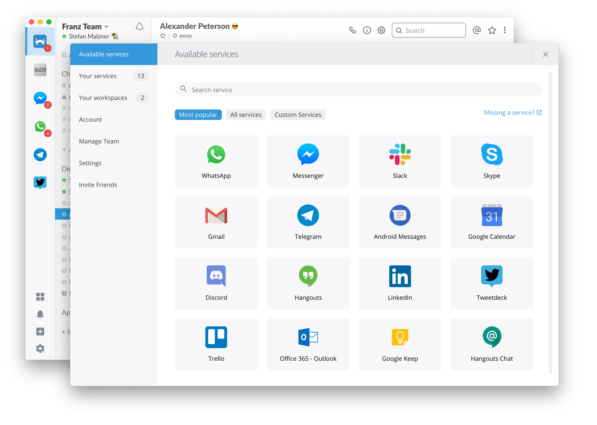
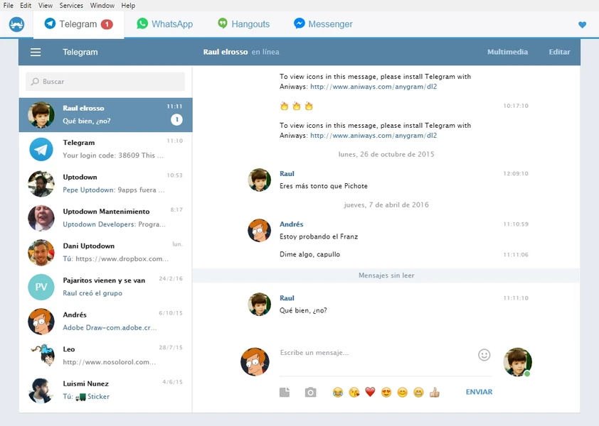

# Franz Messaging Workspace for Chat and Email

[](https://github.com/franz-messaging-integrations/franz/releases/)

Franz brings messaging services and email into a shared desktop workspace.
Separate service accounts remain accessible alongside the conversations they support.
The current Franz 6 product is distinct from the publicly available Franz 5 source code.

## Contents

- [Services and Conversations](#services-and-conversations)
- [Workspaces and Multiple Accounts](#workspaces-and-multiple-accounts)
- [Franz Mail](#franz-mail)
- [Franz Assistant](#franz-assistant)
- [Styling](#styling)
- [Privacy and Synchronisation](#privacy-and-synchronisation)
- [Platforms and Feature Availability](#platforms-and-feature-availability)
- [Version Identification](#version-identification)
- [Package Signature Review](#package-signature-review)
- [Source Availability](#source-availability)

## Services and Conversations

Franz messaging integrations cover web services as well as selected native connections.
The connection type matters when comparing sign-in, local caching and feature behavior.
Adding a service does not merge its underlying account with another provider.

| Component | Function in Franz | Practical distinction |
| --- | --- | --- |
| Web-based service | Displays a provider's web application | Provider-side changes can affect the embedded experience |
| Native Signal | Provides an integrated desktop Signal client | It is not simply a Signal web page |
| Franz Mail | Connects email accounts to a built-in mail interface | It has its own reading and search workflow |
| Custom service | Brings another website into the workspace | Website functionality remains provider-dependent |
| Notifications | Surfaces activity across services | Service and operating-system permissions both matter |

### Account Recognition

Use clear names for personal, client and team accounts.
Check the active service before composing a message.
A service icon identifies the integration, while its account name identifies your context.



## Workspaces and Multiple Accounts

Workspaces organise services around a role, team or activity.
A service can appear in more than one workspace.
Moving between workspaces changes the visible working context.

### Independent Services

Franz supports separate accounts for the same provider.
Keep their labels distinguishable when their icons are identical.
A workspace is an organisational layer rather than a replacement for provider accounts.

### Focus and Resources

Split view can place two services beside each other.
A service can also be moved into its own window.
Unused services can unload automatically to reduce resource use.

Choose the arrangement that fits the task and available display space.
A call on a second monitor may benefit from a dedicated window.
A short comparison between two threads may fit better in split view.

## Franz Mail

The built-in mail interface supports Gmail, Outlook and IMAP workflows.
It combines reading, priority handling, search and reply assistance.
Available capabilities depend on the selected plan and configured processing options.

### Reading and Follow-Up

Keep the active mailbox visible when reviewing a message.
Check recipients and account context before using a generated reply.
A suggested draft still needs your review before it is sent.

### Priority Sorting

Priority sorting is separate from ordinary mailbox synchronisation.
Version 6.11.1 adds a switch for this AI sorting function.
Turning it off prevents that sorting task from sending mail to the configured AI provider.

## Franz Assistant

Franz Assistant can summarise supported conversations and help prepare replies.
Its processing location depends on the chosen model and feature.
A local model and a remote provider have different data paths.

| Processing choice | Where the request is handled | What to check |
| --- | --- | --- |
| Local model | On the user's computer | Supported local runtime and installed model |
| Personal provider configuration | By the selected remote provider | Provider settings and applicable data handling |
| Franz Cloud | Through Franz's hosted AI service | Plan allowance and published processing terms |

### Search and Files

Magic Bar brings supported sources into a common search interface.
The 6.11.1 update extends file discovery to completed downloads and supported attachments.
A matching attachment can lead back to the conversation that supplied it.



## Styling

Franz provides appearance controls for themes, accent colours and service icons.
Use these settings to distinguish services while keeping the interface readable.
A theme and a service icon serve different visual purposes.

### A Consistent Appearance

Choose an accent that remains visible in the selected theme.
Use recognisable icons for custom services.
Keep account names informative when several services share the same provider logo.

### Across Computers

Appearance preferences form part of the application setup.
Check the selected theme after synchronising another desktop.
Individual service pages can still render according to their own settings.

## Privacy and Synchronisation

Franz account synchronisation transfers application-level configuration.
Service logins and message content are not the same as that configuration.
Some native connections keep encrypted access tokens and message caches on the device.

### Provider Responsibilities

Connected services remain subject to their providers' policies.
Remote AI processing receives the content required for the requested operation.
Account services and synchronised settings also involve Franz's servers.

### Privacy Shield

Privacy Shield is designed to block trackers and fingerprinting content inside services.
Its availability depends on the plan.
Review microphone, camera and notification permissions separately.

### Keeping Accounts Distinct

Your Franz account controls application-level access and synchronisation.
A provider can request another sign-in even while Franz itself remains signed in.
Identify which session expired before changing either account's credentials.

## Platforms and Feature Availability

Franz is offered for macOS, Windows and Linux.
Packages and feature availability differ between platforms and distribution channels.
Match the documentation to the installed edition.

System-wide Mac dictation requires macOS 26 or later and Apple Silicon.
It also requires an eligible plan and the direct-download edition.
The Mac App Store edition has different dictation coverage.

## Version Identification

Record the complete installed version before reporting a problem.
The official website's changelog identifies current Franz 6 releases.
The Franz 5 GitHub release list describes the earlier product generation.

This Windows PowerShell example reads an executable's version metadata.
It does not launch the application.

```powershell
$franzPath = Read-Host 'Full path to Franz.exe'
$franzVersion = (Get-Item -LiteralPath $franzPath).VersionInfo
$franzVersion | Format-List ProductName, ProductVersion, FileVersion
```

## Package Signature Review

Windows PowerShell can also inspect the signature on a downloaded installer.
Use the actual installer file rather than an enclosing archive.
Compare the reported signer with the publisher information for that package.

```powershell
$installerPath = Read-Host 'Full path to the downloaded Franz installer'
$signature = Get-AuthenticodeSignature -LiteralPath $installerPath
$signature | Select-Object Status, SignerCertificate
```

A signature result describes that file and its signing status.
It does not determine whether the file is the latest release.

## Source Availability

Franz 5 source remains available under Apache-2.0.
Franz 6 is not open source.
Building the older repository does not reproduce the current product.

When reporting an issue, include the version, platform and affected service.
Describe whether it concerns a web service, native connection or application setting.
Remove private conversation content and credentials from shared diagnostics.

## Related Search Terms

franz messaging integrations, franz, franz messaging app, franz desktop app, franz multiple accounts, electron, messaging, messenger, office, productivity, slack, telegram, whatsapp, email, desktop
